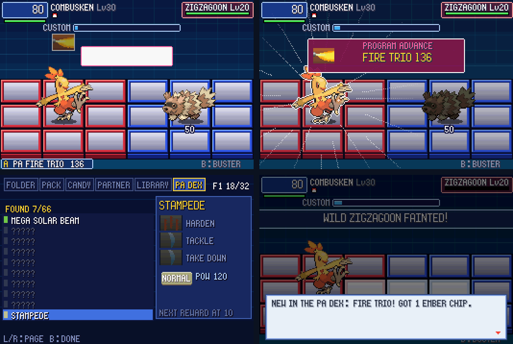

# POC-22: Program Advances as a headline

**Patches:** these go on top of 0001–0088.

- `poc/patches/0089-POC-22-…` and `0090-POC-22d-version-0.22.patch`.
- Applying 0001–0090 onto the pin was checked in a clean worktree.

Your note: Program Advances should be a bigger part of the game. They should be easier to make, met early (by the second
Gym) and rewarded through a PA Dex, and there should be more of them, "but we need to be smart about it". This POC
follows your picks on the "POC-22" page:

- **Easier:** type trios.
- **First one:** no lesson; you find it by playing.
- **Rewards:** all four (the PA Dex page, a chip for each first find, milestones, a Busting point).

*Three Fire chips picked in rising power; FIRE TRIO forms; the PA DEX page in FOLDER; the line after the battle.*

Values marked TUNE are our own numbers. Unless a line cites code, a rule is our own design.

## 22a: Type trios

**The rule.** Three different damaging moves of one type, picked one after another with each at least as strong as the
one before, are a Program Advance: FIRE TRIO, NORMAL TRIO and so on.

- It plays like the third move, as one hit, at 70% of the three moves' power together (TUNE, the number on your picks
  page). Ember → Flame Wheel → Flamethrower is FIRE TRIO 136, a LINE3 like Flamethrower.
- The named recipes are checked first, so a recipe that is also a trio stays the named one.
- **Excluded:** moves whose damage isn't their power (power 1: Seismic Toss, Night Shade, Magnitude), the ??? type, and
  the same move twice.
- If the third move costs the user (Explosion's kind), the trio doesn't.
- As for any Program Advance, the three chips are picked together, so they share a code or are `*`.
- **In code:** `TrioAt` in `src/pkbn/grid_battle.c`. A trio is built into the Program Advance slot it takes
  (`PA_TRIO`, two slots, as the Custom screen holds two Program Advances).

**One thing to watch in playtests.** 70% of the three is less than the three chips would do separately. You still get
one big hit that can't be split up, and the Busting point. If friends skip trios, raise it.

**Your first one by the second Gym, without a lesson.** These are the damaging moves the Pokémon you meet before Brawly
learn by level 19, with the code the three share (`research/poc22/early.py`):

- **NORMAL, code L:** Tackle → Pound → Scratch.
- **FLYING, code W:** Peck → Gust → Wing Attack (Torchic, Wurmple's line, Taillow).
- **FIGHTING, code K:** Arm Thrust → Double Kick → Vital Throw (Makuhita, Torchic).

Water, Grass and Fire don't have a third early move in a shared code. SKY RAID, SPORE BLOOM and SUMO SLAM below are
early too.

## 22b: 18 new named Program Advances (31 → 49)

**How they were chosen** (`research/poc22/`, our design, TUNE):

1. **Fill the gaps.** Bug and Steel had no Program Advance; Flying, Ghost, Dark and Dragon had one each.
2. **Use the codes.** All three moves share a code, so they can be picked together, and they go setup → link → payoff in
   that code's theme (`tools/lanes_curated.py`; the code is in brackets).
3. **Someone can use them.** A Program Advance is done by the Pokémon in battle, which must be able to use all three
   chips. For each recipe, at least one Hoenn line can (`gPkbnCanLearn`). My first draft failed this for five recipes;
   the table is the corrected set.
4. **Do something a trio can't:** status, panels, drain, crits, whole-area hits.

| Name | Recipe | What it does | Who can use all three |
|---|---|---|---|
| SILVER STORM | Whirlwind → Gust → Silver Wind | BUG 150 wind over all three rows, slows (code W) | Beautifly, Dustox |
| SKY RAID | Quick Attack → Peck → Wing Attack | FLYING 130 dive down the row (code A) | Taillow, Swellow |
| AMBUSH FANG | Sand-Attack → Bite → Crunch | DARK 160, locks on, never misses, lowers accuracy (code N) | Poochyena, Mightyena, the Trapinch line |
| MAELSTROM | Rain Dance → Water Gun → Whirlpool | WATER 4 x 35 whirl 2 panels ahead, slows (code R) | Mudkip's line, Wailmer, Barboach |
| SPORE BLOOM | Leech Seed → Stun Spore → Mega Drain | GRASS 110 burst on the target and around it + paralysis (code G) | Shroomish, Breloom, Roselia |
| SUMO SLAM | Focus Energy → Arm Thrust → Vital Throw | FIGHTING 140 slam on three panels, guaranteed crit (code K) | Makuhita, Hariyama |
| STEEL RAM | Metal Sound → Tackle → Iron Tail | STEEL 170 charge down the row (code L) | Aron, Lairon, Aggron |
| BLADE SWARM | Swords Dance → Fury Cutter → Slash | BUG 170 wide cut, guaranteed crit (code U) | Combusken, Absol, Anorith and more |
| ECHO BLAST | Supersonic → Screech → Hyper Voice | NORMAL 160 sound wave over all three rows + confusion (code V) | Whismur, Loudred, Exploud |
| TOXIC FOG | Poison Gas → Smog → Sludge | POISON 120 on every enemy panel, poisons them, lowers accuracy (code O) | Koffing, Gulpin and their evolutions |
| QUICKSAND | Sand-Attack → Sand Tomb → Dig | GROUND 170 from below, slows (code Q) | Trapinch's line, Sandshrew |
| HAUNTING | Astonish → Shadow Punch → Shadow Ball | GHOST 170, locks on, guaranteed crit (code N) | Dusclops (and Gengar) |
| AURORA | Powder Snow → Icy Wind → Aurora Beam | ICE 160 beam sweeping the enemy area, slows (code I) | Spheal's line |
| FOSSIL FURY | Rock Tomb → Ancient Power → Rock Slide | ROCK 180 slam on three panels, cracks them (code Q) | Anorith, Baltoy, Lileep's line and more |
| VERDANT EDGE | Swords Dance → Fury Cutter → Leaf Blade | GRASS 200, two columns of blades, guaranteed crit (code U) | Grovyle, Sceptile |
| BLAZING FURY | Focus Energy → Double Kick → Blaze Kick | FIRE 3 x 70 kicks down 3 panels + burn (code K) | Blaziken |
| SWAMP SURGE | Mud Sport → Water Pulse → Muddy Water | WATER 180 wave over all three rows, lowers accuracy (code R) | Marshtomp, Swampert |
| DRAGONFIRE | Sunny Day → Dragon Breath → Flamethrower | DRAGON 200 fire wave down the row + burn (code S) | Bagon's line, Altaria, Flygon |

- **Early:** SKY RAID, SPORE BLOOM and SUMO SLAM (Taillow, Shroomish and Makuhita are on the routes before Brawly).
- **Each starter's line:** VERDANT EDGE, BLAZING FURY and SWAMP SURGE. Their payoffs come from the starters'
  evolutions (Leaf Blade by Grovyle at 29, Blaze Kick by Blaziken at 36, Muddy Water by Marshtomp at 37).
- **Found while checking:** two of the older recipes, DREAM DEVOURER and Z-SLUDGE, can't be done by any single Pokémon.
  They need a Cross partner who can use the missing chip. I left them as they are; say if you want them changed.
- They're generated like the others (`tools/lanes_curated.py` PROGRAM_ADVANCES, `tools/attacks_curated.py`
  PA_EFFECTS, `tools/gen_move_table.py`).
- The generator now also writes the Unison, Dark Chip and trio indices; until now those were hand edits in
  `move_table.h`.
- **Rivals.** Rivals and Gym Leaders pick their Program Advance from the same table (`RivalPA`), so they can use the
  new ones too.

## 22c: The PA Dex and its rewards

**The page.** FOLDER > **PA DEX**, the sixth tab (R from LIBRARY). It has 66 entries: the 49 named Program Advances and
the 17 type trios.

- **Found:** the name, the three chips, its type and power.
- **Not found:** `?????`, with the recipe chips you own shown.
- **Owning two of the three** reveals the third.
- **Trios** show their type: three type icons with rising bars.
- The page shows **FOUND n/66** and the count where the next reward comes.

**First find.** The first time you form a Program Advance, you get one copy of its rarest chip: the one of its three
you own fewest of, in the code it had.

**Milestones,** every 5 found, in turn (TUNE):

| Found | Reward |
|---|---|
| 5, 20, 35… | Folder +1 chip (up to +3: 43 with a full party) |
| 10, 25, 40… | A NaviCust program: Custom1, then MegFldr1, GigFldr1, Custom2 |
| 15, 30, 45… | A `*` copy of that Program Advance's third chip |

- Once the folder bonus is at +3, that turn gives a program instead.
- What you got shows after the battle: "NEW IN THE PA DEX: FIRE TRIO! GOT 1 EMBER CHIP." and "5 PROGRAM ADVANCES FOUND!
  YOUR FOLDER HOLDS ONE MORE CHIP."
- **Busting Level:** using a Program Advance in a battle adds 1 point.

**Save.** The new fields are appended to `pkbn.sav` v9, and older v9 files start them empty:

- the Dex bits: a fixed 16 bytes, so the layout never moves again;
- milestones paid and the folder bonus;
- the folders' extra slots: the saved folders keep their 40 slots and the bonus ones live after them, so old saves and
  the folder editor work unchanged.

## Verification

- **Regressions:** all 33 self-test battles end as in POC-21. Their Busting lines now show the +1 when a Program
  Advance was used.
- **owtests:** 48 of 48 pass.
- **All 18 new Program Advances** were formed and fired in a self-test each: name, kind, type and power as in the table.
- **New owtests:**
  - `trio_pa`: FIRE TRIO forms.
  - `new_pa_sky_raid`: SKY RAID fires.
  - `padex_milestone`: the 5th find gives folder +1.
  - `padex_page`: the PA DEX page.
- **New test switches:**
  - `PKBN_TEST_HAND="move,move,move"`: the first hand opens with these, in one code.
  - `PKBN_TEST_PADEX="entries"`: these are already found.
  - `PKBN_TEST_PADEX_MILESTONES=n`: milestones already paid.

## Open / TUNE

- The trio's 70%; each new Program Advance's power and effect; the milestone spacing and rewards.
- Whether trios should also need rising power.
- ASSET-002 (the Program Advance storyboard) is with Codex. Once it's accepted, the moment itself gets redrawn.
