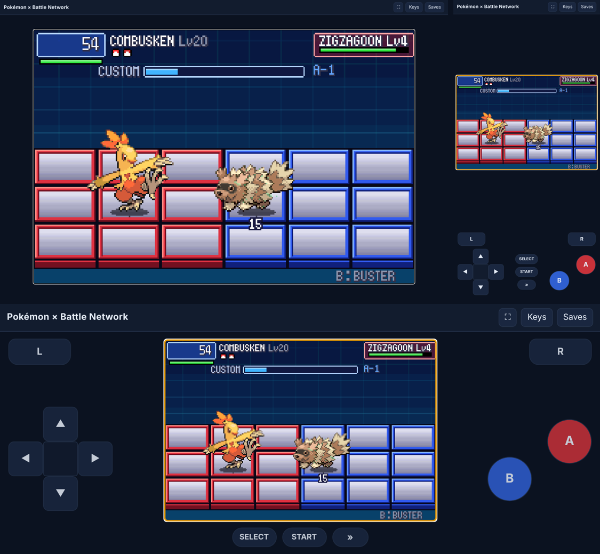

# POC-23: The browser build

**Patches:** these go on top of 0001–0091.

- `poc/patches/0092-POC-23-…` is the browser build, and `0093-POC-23b-version-0.23.patch` sets the version to 0.23.
- Applying 0001–0093 onto the pin gives the same tree as the build tested here (checked in a clean worktree).

The game runs in a browser tab on a computer, phone or tablet. You can use a keyboard, a gamepad or the touch buttons.
Saves are kept in the browser, and a backup can be downloaded and restored. Build it with
`bash scripts/setup_host.sh web`; the result is three files in `poc/bin/web/`.



*A wild battle in Chrome on a computer (top left) and on a phone held upright (top right) and sideways (bottom).*

## How to play it

1. Open the page and wait for **Click or press a key to start** (or **Tap to start**).
2. Browsers only allow sound after a click or tap, so the game starts on that first one.
3. **Keys** at the top lists the keys. They're the desktop keys, including Space for fast-forward. ⛶ goes fullscreen.
4. **On a touch screen** the buttons are drawn on the page:
   - **Held upright:** the screen is on top, with L and the pad on the left, R, B and A on the right, and SELECT,
     START and » (fast-forward, held) in between.
   - **Held sideways:** the buttons are beside the screen, and SELECT, START and » are under it.
   - You can slide a thumb across the pad. A diagonal presses two directions, and a quick buzz confirms a press where
     the phone supports it.
5. **Saves** opens two buttons:
   - **Download a backup** saves every file the game writes as one `.json`. That's `pokeemerald.sav`, `pkbn.sav`,
     the log, the play log and the last replay, which are the files testers send us.
   - **Restore a backup** loads one back into any browser.

## Where saves go

- The game writes its files in the browser's storage for that site (IndexedDB). It's the same set of files the desktop
  version writes next to the .exe.
- They're written out whenever the game saves, writes a ghost or saves a replay. Everything is also written out every
  30 seconds and when the tab is hidden or closed.
- Saves belong to one browser on one device. Clearing the site's data, or playing in a private window, loses them.
  The backup is the way to move a save between devices.
- Ghost codes (NET CHALLENGE > GHOSTS): **copy** puts your code on the clipboard. A browser won't let a page read the
  clipboard without asking, so **paste** opens a box to paste the friend's code into.

## How it's built (`web.mk`, `tools/web/`, `web/`)

- **C** is compiled by Emscripten to 32-bit WebAssembly. The desktop build's own SDL2 platform code
  (`src/platform/sdl2.c`) drives the game, through Emscripten's SDL2.
- **Data:** the data written in assembly (`data/*.s`, the songs) is assembled by the host's `as --32`, as for the PC
  build. Then `tools/web/elf2wasm.py` rewrites each object as WebAssembly assembly with the same bytes, the same
  symbols at the same offsets, and the same pointers.
  - Tables that run into each other stay contiguous.
  - A pointer to a C function becomes a function-table entry.
- **The main loop** is one step per browser frame (`LoopOnce`). The desktop runs the same function in its `while`
  loop.
- **Saves:** `Platform_Persist()` is new and does nothing on the desktop. In the browser it tells the page to write the
  save files out. It's called after a save, a ghost and a replay.
- **Function pointers:** WebAssembly stops the game when a function is called through a pointer of a different type.
  The GBA allows it, and Emerald does it in its data tables. For example, script specials are all called as returning
  a value, and most return nothing. The build links with `-sEMULATE_FUNCTION_POINTER_CASTS`, which makes those calls
  work. In the tests it cost no visible speed: fast-forward still ran.
- **Two upstream lines changed:**
  - The player's empty movement callback (`src/field_player_avatar.c`) is now declared with its real arguments.
  - Mystery Gift's "run code from the buffer" (`src/mystery_gift_client.c`) is off in the browser: WebAssembly can't
    run bytes from memory, and there's no link partner there anyway.
- **Size:** `pokeemerald.wasm` is 18.5 MB, 9.7 MB compressed. Most web hosts compress it, so a first visit downloads
  about 10 MB. The browser caches it after that.

## Tests

- **In the browser:** all 47 overworld and battle self-tests pass in headless Chrome, at 5× speed. Each test's
  `PKBN_*` settings go in the address as `?env=KEY=VALUE`. `replay_play` passes when it runs after `replay_record` in
  the same browser, as it does on the desktop.
- **Saves:** a file written in one visit is there after a reload.
- **Touch and layout:** the touch buttons register a press, and both phone layouts fit the screen with nothing cut off.
- **Desktop unchanged:**
  - The 33 battle regression runs give the same `[pkbn]` log, line for line, before and after this POC.
  - The 48 overworld tests pass.

**Not tested:** Safari (iPhone, iPad and Mac), Firefox, and a real phone. Only Chrome runs here. The first two
playtesters on those would tell us most.

## Hosting

The page is three static files: `index.html`, `pokeemerald.js` and `pokeemerald.wasm`. Any static web host serves them.

These files are the built game, so they hold Emerald's and BN6's graphics and music. That's the same as the playtest
.exe from POC-18, so the same care applies:

- Put them only where your testers alone can reach them, such as a private link.
- Never commit them: `poc/bin/` is in `.gitignore`.
- `CLAUDE.md` rule 6 still says built binaries aren't shared. The POC-18 picks chose to allow private playtest builds,
  but the rule's text hasn't been changed. Amending it is your call.

## Building it

From the project folder in WSL:

```
git clone https://github.com/emscripten-core/emsdk ~/emsdk
~/emsdk/emsdk install 3.1.6 && ~/emsdk/emsdk activate 3.1.6
source ~/emsdk/emsdk_env.sh
sudo apt install python3-pyelftools
bash scripts/setup_host.sh web
cd poc/bin/web && python3 -m http.server 8000      # then open http://localhost:8000
```

- 3.1.6 is the version this was built and tested with.
- The script builds the Linux version first, for its tools and converted graphics, and then the browser version.
- A phone on the same Wi-Fi can open `http://<your PC's address>:8000`, but only after Windows forwards that port to
  WSL. A private host is simpler.
