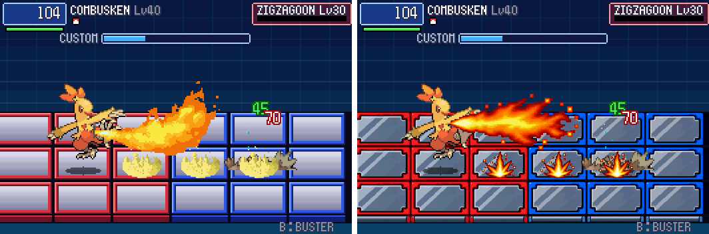

# POC-24: The hi-bit renderer

**Patches:** these go on top of 0001–0093.

- `poc/patches/0094-POC-24-25-…` holds this POC and POC-25 together (they share `gfx.c` and `gfx.h`), and
  `0095-POC-25b-version-0.25.patch` sets the version.
- Applying 0001–0095 onto the pin gives the same tree as the build tested here (checked in a clean worktree).

Battles now draw on a 528×352 canvas, twice the game's 264×176. Codex's approved panels (ASSET-003) and fire effects
(ASSET-004) replace the old ones at that full detail.

*The same Flamethrower in the same self-test battle: the old art (left) and the hi-bit art (right).*

## What changed on screen

- **Panels:**
  - all 12 types, in both colours;
  - the front edge of the bottom row.
- **Fire:**
  - FIREBALL (Ember-type shots), FIRE_BURST (where a Fire move lands), FLAME_JET (Flamethrower and other Fire lines),
    FIRE_TALL (Fire areas) and FIRE_PANEL (Will-O-Wisp).
  - They land where BN6's did and take up the same area, so attacks look different but still go to the same place.
- **The fireball now faces the way it flies.** Before, it always pointed left, so the player's flew backwards. Every
  projectile now knows its direction (`DrawOrb`).
- **Everything else looks as before,** at twice the detail of the buffer: the Pokémon, the other effects, the HUD and
  the text. They change as their art arrives (ASSET-005 onwards) and in POC-25 for the Pokémon.

**Gone for now:** the code-drawn panel animations (bubbling poison, waving grass, crawling road arrows, pulsing lava,
the ice and holy glints). The hi-bit panels are still images. If you miss them, they're a request for Codex: a few
frames per animated panel type.

**`PKBN_HIBIT=0`** draws the old art on the same canvas, for side-by-side checks.

## How it works

- **The canvas:**
  - The buffer is 528×352. Every drawing call still takes 264×176 coordinates (`src/pkbn/render.c`, `gfx.c`), so no
    screen's layout changed.
  - An old picture fills 2×2 buffer pixels per pixel. A hi-bit picture (`struct PkbnImage .hi`) lands pixel for pixel.
- **One path for every picture:** plain, scaled, rotated and blended draws all run per buffer pixel (`DrawPhys`). So
  the turning in Pokémon's entrance animations already gets the finer steps.
- **The window:**
  - It now starts at 1056×704, twice the canvas, and resizes in whole steps of 528×352.
  - `PKBN_SCALE=N` sets the start size in the same steps.
  - Outside battle, the GBA picture is doubled into the canvas with its border.
- **The art pack** (`tools/pack_hibit.py`), run by `setup_host.sh`:
  - It reads Codex's source sheets from `poc/assets/generated/` and writes `include/pkbn/hibit_gfx_data.h`. That's
    generated and gitignored; it's our own art, but it's rebuilt like the BN6 data.
  - Panels: six equal cells per row, shrunk to 88×52 by area average, 16 colours each, hard edges (BROKEN's hole stays
    clear). The front edge is shrunk to 88 wide, then rows are dropped from its middle down to 12.
  - Fire: hard alpha, specks removed, frames split at their gaps, one scale per effect so the burst still grows, up
    to 31 colours. Each effect fills the area BN6's frames covered around their anchor (measured from `sBn6Frames`).
- **Direct pixel code** moved to the new buffer: the screen shakes, the Custom window's slide, the reward picture and
  the post-battle snapshot. Frame dumps (`PKBN_DUMP_DIR`) are now 528×352.

## Tests

- **Battle logic unchanged:** the 33 battle regression runs give the same `[pkbn]` log, line for line, as 0.22 (before
  POC-25's sprites, which don't change logic either; see POC-25).
- **Fire:** a gallery of seven Fire moves, dumped with hi-bit on and off (`PKBN_GALLERY`, `PKBN_HIBIT=0`).
- **Screens:** the Custom screen, the HUD, the overworld (now doubled) and the post-battle screens were checked in
  frame dumps.
