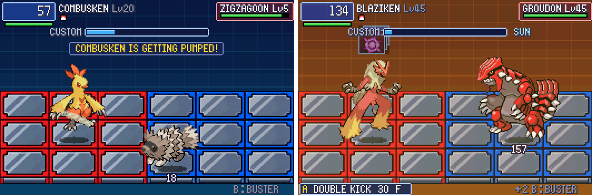

# POC-25: Animated Pokémon from your Black 2

**Patches:** the same as POC-24's: `0094-POC-24-25-…` (both POCs) and `0095-POC-25b-version-0.25.patch`.

In battle, every Pokémon (national 1–386) can now use its Black 2 sprite: fully animated, upscaled 2× with xBRZ, in
its own colours. The sprites come from **your own copy** of Pokémon Black 2 / White 2 at build time. Nothing extracted
is committed or shipped.



*Black 2's Combusken and Zigzagoon (left); Blaziken and Groudon in Groudon's drought (right). All drawn on the hi-bit
canvas from POC-24.*

## Turning it on

From the project folder in WSL:

```
PKBN_SPRITE_ROM=~/path/to/your-black2.nds bash scripts/setup_host.sh windows
```

- The build compiles xBRZ once, then imports the sprites into `pkbn_b2_sprites.bin` next to the game (and the .exe,
  and the browser build's folder). That takes about half a minute.
- Without `PKBN_SPRITE_ROM`, or without the file, the Pokémon keep Emerald's pictures, as before.
- `PKBN_B2=0` turns them off for a run, and `PKBN_HIBIT=0` turns off all the hi-bit art.
- `PKBN_SPRITES=/path/file.bin` loads a sprite file from somewhere else.

## What you see

- **Black 2's own animation:** each Pokémon plays its idle loop with its occasional action (Torchic blinks, Groudon
  opens its jaws). The attack pose (Emerald's second frame until now) shows Black 2's action pose.
- **Each side has its own clock,** so the two don't move in step. It stops while a Pokémon is asleep, frozen or
  stunned.
- **Everything that changes a Pokémon's look still works:** facing (the player's is mirrored, as before), hit flashes
  and status tints, shadows, entrance animations, after-images, fainting, and the Unison palette fusion (now worked
  out on the Black 2 palette).
- **Shiny Pokémon** use Black 2's shiny palette.
- **Emerald's picture stays** for Unown (its letter), Spinda (its spots) and Deoxys (Emerald's is the Speed Forme;
  Black 2's archive has the Normal Forme at 386). The same goes for anything outside the battle screen for now:
  menus, NaviCust, the party icons.

## How it works

**The format.** Black 2 stores battle sprites in its archive `a/0/0/4`, 20 files per species (magical's
[pokemon-nds-sprites notes](https://github.com/magical/pokemon-nds-sprites/blob/master/docs/pokegra.rst)). Each is a
cut-out puppet. Here's what we found, by rendering species and checking them against the art:

- **The parts sheet (NCGR):** a 256×128 bitmap read with 2D tile mapping (cell mapping value 4). Its pixel data
  starts at the offset the block gives, counted from after the block header.
- **Cells (NCER):** parts are affine and double-size, so the picture sits centred in a box twice its size. Their
  rotation-matrix bits aren't flips.
- **Cell animations (NANR):** frames are 16-bit count, loop start, element type (index / rotate-scale-move / move).
  Rotations are small, often 1–3°, at 5 frames a step.
- **Poses (NMCR)** layer the cells, back to front by each node's order byte. **The sequence (NMAR)** alternates the
  idle pose and the action pose.

**The importer** (`tools/import_b2_sprites.py`, run by `setup_host.sh`):

- It reads the `.nds` file system itself, so no extra package is needed.
- It upscales each parts sheet 2× with xBRZ and snaps every pixel back to the sprite's 16 colours, so it stays pixel art.
- It keeps each part's pixels at 4 bits and the animation tables, for species 1–386.
- The result is 7.2 MB (1.3 MB compressed).
- Reading your actual `.nds` gives the same bytes as reading the archive, checked on three species.

**xBRZ** (Zenju; the `ioistired/xbrz.py` source at a pinned commit, AGPL-3.0):

- It's compiled on your machine as a build tool. Its Python glue is left out, so no Python headers are needed.
- It never goes into the game or the repo.
- Without it, the importer falls back to Scale2x.

**In the game** (`src/pkbn/monsprite.c`):

- The file is loaded at start.
- Each tick, the pose is built for each Pokémon on screen: the sequence, then the pose's cells, each cell's animation
  frame, and each part turned and scaled around its cell's origin, per pixel at 2×.
- The pose is cropped and handed to the existing fighter drawing as a hi-bit picture.
- **Replays:** the battle state (which replays save) only holds each picture's national number and palette. The
  rendered poses live in a cache outside it.

**The browser build** fetches `pkbn_b2_sprites.bin` from beside `index.html` when it's there.

## Tests

- **Every species,** front and back, parses with no errors (1,298 combinations in the archive).
- **In battle:** Combusken vs Zigzagoon and Blaziken vs Groudon with frame dumps. Pose, facing, the action pose and
  weather all render.
- **Battle logic unchanged,** with and without the sprite file (see the regression runs in the change log).

**Not done yet:**

- **Female forms:** Black 2 has them; Emerald has no gender differences, so they're left out for now.
- **The back sprites:** unused, since the battle is side-on.
- **Black 2 sprites outside the battle screen.**
