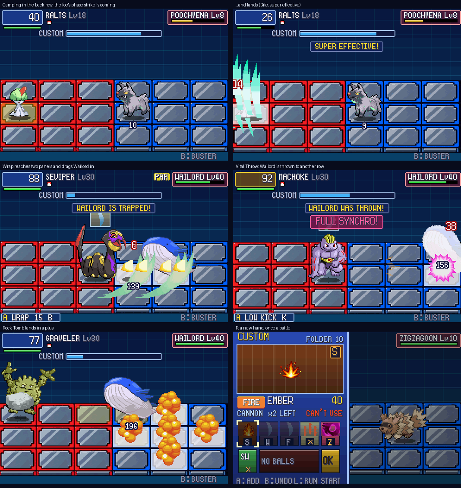

# POC-26: Out of the buster rut

**Patches:** `0096-POC-26-…` (the gameplay), `0097-POC-26b-version-0.26.patch` and `0098-POC-26c-…` (one `*` per chain), on top of 0001–0095.

Your play log from 14 Oct showed why wild battles had turned into holding B with fast-forward on:

- Ralts could use 3 of the 13 chips in your folder.
- Its buster does 1 damage a shot at any level, against wild Pokémon 9 to 14 levels below it.
- 77% of its battle time was spent in the back column.
- The rest of the party never joined in.

This POC is the set of changes you picked over three rounds. The numbers are all TUNE.



*Top: a wild Poochyena punishes camping with a phase strike. Middle: Wrap drags its target in; Vital Throw throws it
to another row. Bottom: Rock Tomb lands in a plus; the Custom screen's one new hand a battle.*

## Wild battles push back

- **Phase strikes (P2).** Stand in your back column for 3 seconds of fighting and a wild Pokémon stops waiting:
  - It blinks to its front column in your row and strikes your panel with its strongest contact move (its strongest
    damaging move if it has no contact move).
  - Your panel lights up first, like any panel attack, so you can step away.
  - The longer you keep camping, the shorter the warning: 60 frames at first, down to 24.
  - While it's winding up, the striker is open, so hitting it then is a counter hit.
  - Stepping out of the back column drains the build-up four times as fast as it builds. Wild battles only for now.
- **More of them (C2).** The further your lead is above the wild Pokémon, the likelier a pack:
  - 5 or more levels ahead adds 20 points to the chance of a pair and 5 to a trio;
  - 10 or more adds 40 and 20;
  - the badge odds from POC-11 stay underneath.
- **Counter hits fill the gauge (X1).** On top of the stun and Full Synchro, a counter hit fills a quarter of the
  Custom gauge.

## Moves that move things

| Picks | Moves | What happens |
|---|---|---|
| M1 | Bind, Wrap, Constrict | They now reach two panels (long sword) and drag the target one panel toward you. Bind and Wrap then hold it, as before |
| M1 | Whirlpool, Sand Tomb, Fire Spin | They drag the target one panel in as the bind takes hold (once, not every tick) |
| M2 | Mean Look, Block, Spider Web | They pull the target to its front column before it's held |
| M3 | Seismic Toss, Vital Throw, Submission | The target is thrown to its back column on another row, in an arc, and stunned for half a second |
| M4 | Mega Punch, Mega Kick, Body Slam, Dynamic Punch, Focus Punch, Sky Uppercut, Crabhammer | They knock the target back a panel, like Strength |
| M6 | Take Down, Double-Edge, Volt Tackle | After the hit, the user bounces back a panel |

- **All of these work both ways.** A wild Seviper's Wrap drags you out of your back row.
- **Not affected:** Ingrain, Suction Cups and the SuprArmr program anchor a Pokémon against all of them.
- **Clamp** keeps its hold without the pull: it only reaches the next column, so a pull there would do nothing.
- **Priority moves:** Quick Attack, Extreme Speed and Fake Out already strike the target's panel from anywhere, as you
  said, so they're unchanged.
- **A fix along the way:** knock-backs used to slide in from the wrong side. A pushed Pokémon now slides from where it
  was to where it lands.

## Rock Tomb (R1)

It now lands in a plus. Only the middle panel pins the target, and the four arms only do damage.

## Chips and codes

- **Tag chips in chains (T1).** A teammate's chip can now be picked on the Custom screen, but only to continue a
  chain: it must share the code of the chips above it, or be the same chip. It can't start a turn.
  - When the chain reaches it, time stops and the teammate who can use it (the highest level, if several can) hops in
    for that one move. "TAG: TORCHIC!" shows during the time stop.
  - The Pokémon in battle stays in.
  - The teammate counts as having fought, so it shares the EXP (A4).
- **Codes unlock as you go (T3, K1).**
  - New chips only come in unlocked codes: drops, capture rewards, the Mart, TMs, learned moves, hidden data and the
    Chip Trader.
  - You start with 6, plus `*`. Each Gym Leader and each rival battle won unlocks 2 more:
    - the rival battles are Route 103, Rustboro, Route 110, Route 119 and Lilycove;
    - all 25 codes are open after 10 of these.
  - A chip whose codes are all still locked takes one of the unlocked codes: the same one every time for that move, so
    its copies chain with each other. **This differs from K1 as you picked it,** which said it would come as `*`. In one
    overworld test that made 15 of the 18 chips in the folder `*` (Combusken's Ember, Double Kick, Focus Energy and
    Peck, Wingull's Water Gun), and those chain with anything. That's a lot more chaining than "6 codes" suggests. Say if you'd
    rather have the `*`.
  - The order (`AVLHGTQKYZONFUSMCEXRWPBID`) is a greedy cover of the moves early Hoenn Pokémon learn by level 25. The
    first 6 fit three in four of them.
  - Chips you already own keep their codes.
  - Your save should start with 10 codes (A V L H G T Q K Y Z): 1 badge, and the Route 103 rival, going by the partner
    slot your log shows. UNVERIFIED: I haven't read your save.
- **New chips lean toward your codes (T2).** When a new chip could come in more than one unlocked code, half the time
  it takes the one your folder already has the most of. That's the equipped folder, or the whole pack while the folder
  is auto-built. A `*` (a rare drop, a shiny catch) stays `*`. Shop shelves and the candy list don't roll: they show a
  fixed unlocked code.
- **One `*` per chain (POC-26c, patch `0098`).** A chain may hold at most one `*` chip. A second `*` can't join, even
  the same chip, and the Unison's `*` third chip can't follow a `*`. Tested with a forced hand of three `*` chips: the
  second can't be picked.
- **One new hand a battle (D5).** On the Custom screen, before you pick anything, R puts the whole hand under the pile
  and deals a new one. The footer shows "R:NEW" while you still have it.

## Tests

- **New self-tests** (`run26` below; frame dumps in `poc/screens/POC-26.png`):
  - **Camping:** Ralts Lv 18 with the buster-only bot against a Poochyena Lv 8. Two phase strikes (warnings 39, then
    24 frames). With a 60-frame reaction the bot is hit by Bite for 14; with the default 15 it dodges both.
    `PKBN_NO_PHASE=1` turns them off.
  - **Pull:** Wrap pulls Wailord from column 4 to 3. Mean Look pulls it to the front column.
  - **Throw:** Vital Throw throws Wailord to (5,0).
  - **Recoil bounce:** Double-Edge and Take Down.
  - **Rock Tomb:** plus pattern.
  - **Redraw:** the hand changes; the footer before and after.
  - **A foe's Wrap** on the player.
- **Battle regressions (33):** all finish. 15 have the same `[pkbn]` log as 0.25. The rest change where the new rules
  apply:
  - the codes of rewards (e.g. KARATE CHOP U is now L; a `*` drop stays `*`);
  - counter hits filling the gauge, which moves every later turn;
  - one chained tag (t5: Vulpix's Will-O-Wisp after Snorlax's Fire Blast);
  - knock-backs that are now logged.
- **Overworld tests:** 48/48. Four test fixes went with this:
  - `struggle`'s Wailmer is now level 40. Chains of one code now use up its 18-chip folder faster, and the buster
    could win before the Struggle chip came.
  - `replay_identical` leaves out Bond lines: Bond is saved progress, which a replay never touches.
  - `field_grass` fights with Combusken alone (Ember, Growl), so a Fire chip is sure to come up before the battle is
    won.
  - The battle autopilot now heads for the next selectable chip. Stepping cell by cell, it circled past a teammate's
    chip that only became selectable mid-chain.
- **A bug found on the way:** Focus Energy and Charge used to be remembered in the two spare bits of a move's flags,
  the same two bits the pull and the throw now use. So after Focus Energy, every move threw the target. They have
  their own fields now.

```
# from the host build folder
run(){ n=$1; shift; SPEC=$(python3 ids.py "$1"); shift; env "$@" PKBN_SELFTEST="$SPEC" SDL_VIDEODRIVER=dummy ./pokeemerald64 > $n.log; }
run camp "RALTS:18:CONFUSION/GROWL/DOUBLE_TEAM/TELEPORT,POOCHYENA:8:TACKLE/HOWL/SAND_ATTACK/BITE" PKBN_BOT=buster
run pull "SEVIPER:30:WRAP/BITE/POISON_TAIL/GLARE,WAILORD:40:SPLASH"
run throw "MACHOKE:30:SEISMIC_TOSS/VITAL_THROW/SUBMISSION/LOW_KICK,WAILORD:40:SPLASH"
run redraw "RALTS:18:CONFUSION/GROWL/DOUBLE_TEAM/TELEPORT|TORCHIC:16:EMBER/PECK/SCRATCH/GROWL,ZIGZAGOON:10:TACKLE" PKBN_TEST_REDRAW=1
```

## Next

- **POC-27, the themed places (C3):** the tide on beaches and sea routes, falling rocks in caves (new grid objects),
  snares in tall grass, and puddles on rain routes.
- **Phase strikes for trainers,** once you've played with them in the wild.
