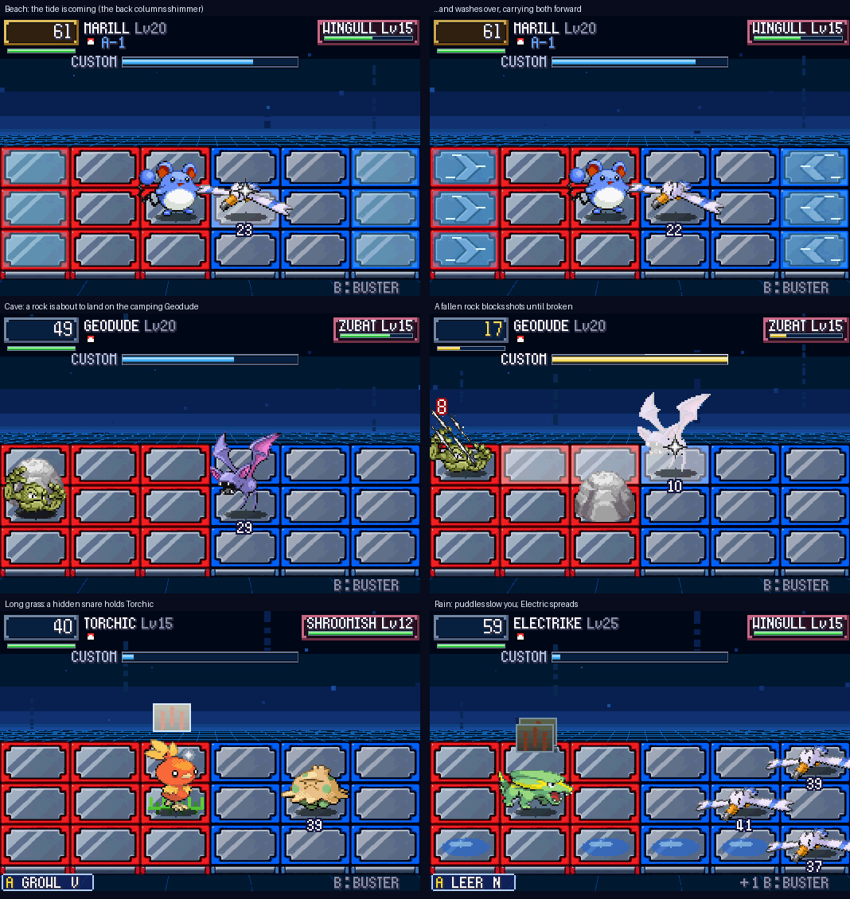

# POC-27: Places with their own grid

**Patches:** `0099-POC-27-…`, on top of 0001–0098 (version 0.28 comes with POC-28).

Your picks C3a–d: the place you're standing in now shapes the fight, the way the grass, caves and gyms already shape
the panels. Each place has one thing the battle keeps doing to the grid, so it plays differently there, not just
looks different. All numbers are TUNE.

*The tide coming and washing over; a fallen rock blocking shots in a cave; a hidden snare holding Torchic; puddles in
the rain.*

## Where and what

| Place | When | What happens |
|---|---|---|
| **Beaches and the sea** | Battles on sand or on the water | **The tide.** Every 7 seconds both back columns shimmer for a second, then wash over for 1.2 seconds. Their panels turn into currents that carry whoever stands there one panel toward the middle, both sides alike. Camping in the back column gets you moved |
| **Caves** | Battles in a cave | **Falling rocks.** Every 6 seconds a shadow grows on a panel, on your panel 6 times in 10. After a little over a second a rock lands. Whoever is there takes 1/8 of their HP and is stunned for a moment. On an empty panel the rock stays (two at most) |
| **Woods and long grass** | Petalburg Woods and long-grass battles | **Hidden snares.** Two on each side, on grass panels when there are any, never where a fighter starts. Step on one and you're held for 50 frames, and the snare shows. Grass and Bug types, and floating Pokémon, walk over them |
| **Rain** | Any battle in the rain | **Puddles.** Two on each side. A puddle halves the stepping pace of anyone who isn't a Water type or floating. An Electric hit on someone standing in a puddle shocks everyone else in the same pool of joined puddles for half the damage. Electric and Ground types, and floating Pokémon, are immune |

- **Fallen rocks** are obstacles:
  - Nobody can step on them.
  - They stop the buster, cannon lines and projectiles.
  - Three buster shots break one. A charged shot, or any move that reaches it, breaks it at once.
- **Gyms and the Elite Four** keep their fields as they were.
- **Mixing:** places can mix. Rain in a cave would bring both rocks and puddles.

**Long grass only, not all tall grass:** your pick said "woods and tall grass". Nearly every wild battle happens in
tall grass, so snares there would be in almost every fight. They're in Petalburg Woods and long grass (Routes
119–120, the Safari Zone) instead. Say if you want them everywhere.

## How it looks

- **The art is drawn in code for now:**
  - The tide is a cyan shimmer, then the current panels with foam lines.
  - The shadow is an ellipse.
  - The rock is BN6's boulder.
  - The snare is a knot of vines.
  - Puddles are blue ovals on the panel.
- **Codex request:** ASSET-011 asks for our own versions of all of these.

## Code

`src/pkbn/grid_field.c`:

| Function | What it does |
|---|---|
| `Place_Start` | Sets the place up when the battle starts |
| `Place_Update` | Runs the tide and the rocks once a frame |
| `Place_HitRock` | Damages or breaks a fallen rock that an attack reaches |
| `Place_Conduct` | Spreads Electric damage across a pool of joined puddles |
| `Snare` | Springs a hidden snare on whoever steps onto it (called from `Field_Step`) |

- **Choosing the place:** `Field_StartConditions` picks it from Emerald's battle environment
  (`BattleSetup_GetEnvironmentId`: sand, water, cave, long grass), the map section (Petalburg Woods) and the battle's
  weather.
- **New panel type:** `PANEL_PUDDLE`.
- **Where the rocks and puddles hook in:**
  - **Rocks:** `Field_CanStand`, the cannon lines (`DirectCells`), projectiles, `StrikeCells` and the buster.
  - **Puddle pace:** `Speed_StepFrames`.
- **Self-tests:** `PKBN_TEST_PLACE=tide,rocks,snares,puddles`. Adding `flood` turns every panel into a puddle, as a
  conduction test.

## Tests

- **Battle regressions (33):** the same `[pkbn]` log as before. Self-tests have no place unless they ask for one.
- **New self-tests** (frame dumps in the screenshot above):
  - **Tide:** washes over at f361 and f923.
  - **Rocks:** one lands on the camping Geodude at f381, one stays on (2,1) at f811.
  - **Snares:** Torchic is snared at (2,1).
  - **Puddles:** with every panel a puddle, Thundershock on one Wingull shocks the other two. The Electric-type user
    is immune.
- **Overworld tests:** 51/51, including three new ones:
  - `place_rain`: Route 120 in the rain gives puddles.
  - `place_cave`: Granite Cave gives rocks.
  - `place_woods`: Petalburg Woods gives snares.
