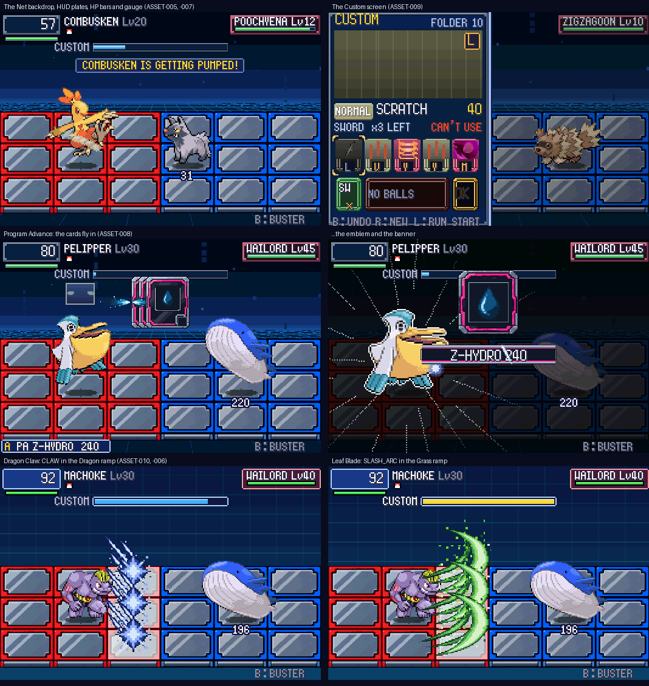

# POC-28: Codex's art through the whole battle

**Patches:** `0100-POC-28-…` (the art in the renderer) and `0101-POC-28b-version-0.28.patch`, on top of 0001–0099.

Everything Codex delivered and we approved is now in the game: the Net backdrop with its streams and motes, the HUD,
the Custom screen, the hits, the strikes and the Program Advance moment. That covers ASSET-005 to ASSET-010 (all six
reviewed and accepted), drawn by the hi-bit renderer from POC-24. Like the panels and fire, the art is packed from
`poc/assets/generated/` by `tools/pack_hibit.py` into the generated `include/pkbn/hibit_gfx_data.h`. `PKBN_HIBIT=0`
still shows the old look.

## What changed on screen

| Asset | Where | What it does |
|---|---|---|
| ASSET-005 backdrop | Behind every battle | Codex's Net sky and floor. 4 data streams drift up the sky at different speeds, and 12 motes twinkle and wander above the horizon. Rain, sun, sandstorm and hail lay a wash of their colour over the sky |
| ASSET-006 impacts | Every hit | HIT, HIT_SMALL, HIT_STAR, DUST, EXPLODE, EXPLODE_SMALL and SMOKE replace BN6's sprites, where BN6's sat. The grey ones take the move's **type ramp**: a Steel hit is steel, a Dragon one blue. Normal stays grey-white; critical hits keep their white flash |
| ASSET-007 HUD | Top of the screen | HP box and foe plate (9-sliced to fit names of any length), the gold Full Synchro plate, status and NCP tags in their colour, HP bars (green / yellow / red fill), the Custom gauge with the light running round when it's full |
| ASSET-008 Program Advance | When one forms | The three chips' cards fly in with their trails, each showing its move's type symbol. They turn edge-on as they meet, the burst in the PA's type plays behind the emblem arriving, then the settled emblem shows the PA's type symbol, with the name banner and its shine. Same 44 frames as before |
| ASSET-009 Custom screen | The Custom screen | The window, the art frame, slots in each chip's colour (dimmed when it can't be picked), the gold bracket cursor, OK, the chosen-chip tabs and the PA preview |
| ASSET-010 strikes | Close-range moves | SLASH, SLASH_ARC (whips, wide blades), CLAW and the new STAB (beaks, horns) and JAWS (bites), all in the move's type ramp. BN6's upright SPIKE stays for Dig |

**Not used yet:** H5, the line for the next queued chip. The game doesn't draw that line in a box today; it's packed
for when it does.

## How it works

- **Packing (`tools/pack_hibit.py`):**
  - **Effect sheets:** their cells are BN6's extents doubled, so each is placed centred on BN6's box and lands where
    today's effect does.
  - **Grey art** keeps the five greys as palette indices 1 to 5.
  - **Type ramps:** the 17 ramps (`type_ramps.json`) are packed by the game's type order.
  - **Still pictures:** the backdrop, HUD parts, Custom parts, PA parts, motes and streams go into one table
    (`HI_*` in `include/pkbn/gfx.h`).
- **Colouring (`src/pkbn/gfx.c`, `grid_vfx.c`):** a grey effect drawn with a type tint swaps its palette for that
  type's ramp (`Gfx_HiRamp`), instead of blending toward one colour. Grey HUD and Custom parts are coloured from a
  single colour (`Gfx_GreyTint`), for the HP colours, chip types and tags.
- **9-slice:** `Gfx_DrawSlice9` stretches plates, tags, bars, slots and the banner. The corners stay as drawn and the
  edges repeat.
- **New effect ids:** STAB and JAWS have no BN6 counterpart, so they're new ids (`FX_HI_STAB`, `FX_HI_JAWS`). Without
  our art they fall back to SPIKE and FANG.

## Tests

- **Battle regressions (33):** the same `[pkbn]` log as POC-27. This is drawing only.
- **Overworld tests:** 51/51.
- **Frame dumps:**
  - a 15-move gallery (Karate Chop, Scratch, Crush Claw, Bite, Peck, Vine Whip, Tackle, Self-Destruct, Metal Claw,
    Dragon Claw, Slash, Crunch, Poison Sting, Leaf Blade, Egg Bomb);
  - a battle;
  - the Custom screen;
  - Z-HYDRO forming (PA self-test p1).
